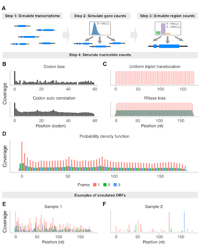

# coverageSim
### Simulating Ribosome profiling data for tool validation



## How to install
```r
if (!requireNamespace("devtools", quietly = TRUE)) install.packages("devtools")
devtools::install_github("Roleren/coverageSim")
```

## Simple example

Lets make a genome with 6 genes, each being coding (they have a CDS) and
having 1 translated uORF:

```r
library(coverageSim)
library(ORFik)
## Simple example
# 6 genes on 6 chromosomes (1 active uORF each)
simGenome6 <- simGenome(n = 6, max_uorfs = 1)
# Simulate Ribo-seq only
gene_count_table <-simCountTables(loadRegion(simGenome6["txdb"], "cds"),
libtypes = "RFP", print_statistics = FALSE)
region_count_table <- simCountTablesRegions(gene_count_table,
     regionsToSample = c("leader", "cds", "trailer"))
df <- simNGScoverage(simGenome6, region_count_table)
```

The ORFik experiment object (df), now contains all linkers to resulting files.

## Convert to other track formats

```r
# Convert to bigwig
ORFik::convert_to_bigWig(df)

```
ORFik supports multiple other formats to convert to, also coverageSim internally has
an option to export simulated libraries directly as `.ofst`, `sam`, or `bam`
through `simNGScoverage(libFormats = ...)`.

## Relevant paths for other programs

```r
# Transcript annotation (.gtf)
gtf_path <- ORFik:::getGtfPathFromTxdb(loadTxdb(df))
# Genome sequences (.fasta)
fasta_genome_path <- df@fafile
# NGS track files (.bigwig, pairwise for forward and reverse strands)
bigwig_paths <- filepath(df, "bigwig")
```

## Export to IGV

- Open IGV,
- Press "Genomes" tab (top left), "Create .genome file"
- Unique Identifier: "Sim genome", Descriptive name: "Sim genome", 
- FASTA file: input fasta_genome_path above
- Gene file: input gtf_path above
- Press OK

Now load bigwig files by: 

- Press "File" (top left), "Load from File"
- load all paths from bigwig_paths above

You now have genome, gtf and tracks loaded in IGV

## Realistic RFP settings (opt-in)

`options(coverageSim.codon_bias = codon_bias_preset("realistic"))` plus `do.call(simNGScoverage, c(list(...), realistic_rfp_settings()))` give lower clumping and replicate frame noise closer to real data (backclaude t69; defaults are unchanged). The learned geometry/frame bias in `inst/extdata/realistic_rfp_geometry_SRR12651187.rds` come from SRR12651187 (6 M read subsample, 2264 canonical transcripts, `learn_fragment_geometry()` / `learn_end_bias(by_length = TRUE)`). The simulated window band is now narrower than real, so a false-flag test on simulated data is conservative; see `docs/REALISTIC_RFP.md`.

## Multi-isoform genes (opt-in, backclaude E17-S7)

`x <- simIsoformGenes(1000, ref_minor_frac = 0.3)`; `simIsoformReads(x)` gives ribosome (replicates) and RNA reads from one isoform mixture in the codon coordinates of the reference (MANE-like) isoform, with the truth expectation `E_truth` next to the flat reference expectation `E_flat` (`isoform_expected()`); n_iso, reference weight and isoform-specific CDS fraction are resampled from 17,935 real human genes (20.7 % have a reference weight < 0.5). `te_sd` / `rna_weight_sd` make the ribosome and RNA mixtures differ. A separate layer: `simGenome()` / `simNGScoverage()` and all defaults are unchanged. Truth check: `scripts/s7_truth_check.R` (flat vs RNA-mixture vs truth).

`codon_bias_options(tau2 = c(cds = .., utr5 = .., utr3 = ..))` (backclaude E17-S9, default 0 = identical output) adds a replicate-shared log-normal factor per 90-nt block (relative variance tau2, same in all libraries of a genome, independent of the codon pauses), per region. A window-aligned cross-replicate estimator (E7/A `tau2_estimate`) recovers the configured value (0.92-1.06x); windows straddling two blocks see about half, so set tau2 to ~2x the target for unaligned windows. Human values: CDS 0.026-0.039, 5'UTR 0.15-0.19, 3'UTR 0.25-0.45; the simulator needs ~1.5-2x the human value to pass the same band. Truth check: `scripts/s9_truth_check.R`.

## Paralog families and multimappers (opt-in, backclaude E17-S8)

`f <- simParalogFamilies(200, k = 3, divergence = 0.2, shares = "unequal", planted = list(member = 1, factor = 1/3), leak = 0.2)` builds near-identical genes on a codon grid with member-specific positions (fraction `divergence`), true member reads `Y`, an all-mapper track `A` (every multimapper counted in full at each member it maps to) and a unique-mapper track `U` (member-specific reads, plus optional mismatch-tolerant leakage from other members); `paralog_totals(f)` sums per library. Unequal expression, family size and a planted abundance change per condition are configurable. A separate layer, defaults of the existing simulator unchanged. Truth check (naive all-mapper vs U/q vs EM, E7/B rule): `scripts/s8_truth_check.R`.

## 3'UTR plateaus, APA step and depleted 3' end (opt-in, S10)

`options(coverageSim.utr3 = utr3_preset("human"))` makes the 3'UTR of `simNGScoverage()` structured instead of flat: replicated ribosome-specific plateaus (4.5 % of 90-nt windows, median fold 3, proximal half, RFP only), an internal poly(A) site in 54 % of 3'UTRs with 0.51x coverage downstream (all library types), and the last 25 nt at 0.07x (RFP). Sites are drawn once per genome, shared by all libraries, and written to `utr3_features.tsv` (`draw_utr3_features()` reproduces them). Defaults: all off. Sources and numbers: `?utr3_options`, `docs/EXPLAINABILITY_PORTS.md`.

## Study, tissue and library codon dwell (opt-in, S12)

`options(coverageSim.codon_dwell = codon_dwell_preset("human"))` with `assign_dwell_groups(count_table, study, tissue_group, peaky)` adds, on the codon weights: the H1 context dwell (offsets -10..+5 around the A site, `inst/extdata/codon_dwell_human.csv`), a codon x offset deviation per study and a smaller one per library (true dwell profiles correlate 0.88 within and 0.37 between studies, as in the human dwell atlas), tissue deltas (built in: "striated") and peaky libraries (1.5x top-10-codon share, 1.6x extra-Poisson variance). The profiles used are written to `codon_dwell_profiles.tsv` (`library_dwell_profile()`). Defaults: all off. See `?codon_dwell_options` and `docs/EXPLAINABILITY_PORTS.md`, which also lists every explainability iteration with its simulator setting and an example combining all ports.

## Learn end biases independently of the simulation inputs

`learn_end_bias()` estimates 5-prime and 3-prime sequence preferences from a
complete-fragment genomic Ribo-seq BAM. Supply its matching reference and
annotation, and an explicit length-specific offset table. These learning inputs
can differ from the genome, count table and region proportions used for simulation.

```r
devtools::load_all(".")

# Select matching, unambiguous transcript/CDS annotations for the real sample.
transcripts <- ORFik::loadRegion(real_txdb, "mrna")
cds <- ORFik::loadRegion(real_txdb, "cds", names.keep = names(transcripts))

# Learn supported lengths, their empirical probabilities and one A-site offset
# per length from frame evidence in the same BAM.
geometry <- learn_fragment_geometry(
  bam = "real_sample.bam", transcripts = transcripts, cds = cds
)
learned <- learn_end_bias(
  bam = "real_sample.bam", fasta = "matching_reference.fa",
  transcripts = transcripts, cds = cds,
  fragment_geometry = geometry, k = 1, by_length = TRUE
)
saveRDS(learned, "learned_end_bias.rds")

# No original BAM is needed for later simulations. Choose the simulation's
# own geometry, genome and region counts independently.
simulation_geometry <- list(source = "default", site_reference = "a_site")
simulation_geometry$five_prime_bias <- learned$five_prime_bias
simulation_geometry$three_prime_bias <- learned$three_prime_bias
simulation_geometry$codon_bias <- learned$codon_bias
simulation_geometry$frame_bias <- learned$frame_bias
simulation_geometry$five_prime_bias$strength <- 0.5
simulation_geometry$three_prime_bias$strength <- 1
simNGScoverage(
  simGenome = simulated_genome,
  count_table = simulated_region_counts,
  seq_bias = learned$sequence_bias,
  fragment_geometry = simulation_geometry
)
```

The fit compares observed reads with possible CDS fragments, including positions
with zero reads. It jointly estimates both end effects and nuisance codon effects,
conditioning on transcript-by-length totals. A positive ridge penalty stabilizes
sparse motifs. `k = 2` or `k = 3` allows longer motifs; `by_length = TRUE` estimates
separate end, codon and frame profiles per supported length. Missing length/motif combinations in a
profile retain the simulator's neutral fallback. The fitted codon effects are
returned as `learned$sequence_bias`. This table also stores the robustly estimated
Dirichlet-multinomial concentration. When it is passed as `seq_bias`, the default
`dmn_alpha_scale = NULL` uses that learned concentration automatically. An
explicit numeric `dmn_alpha_scale` always overrides it; profiles without a
learned value fall back to `1`.

Inspect `learned$diagnostics` for used/excluded read counts, motif support and fit
convergence. The BAM is read in chunks, retaining counts per distinct alignment.
The end learner requires one supplied or learned offset per length and complete CDS
annotations. It excludes clips, indels, paired reads, low-quality/secondary/
supplementary mappings, NH>1, ambiguous transcript assignments, and reads whose
assigned site is not at a CDS codon boundary. Duplicate flags alone are retained.
It estimates transferable sequence preferences under these assumptions, rather
than identifying an enzyme-specific effect or providing confidence intervals.
Length probabilities and offsets come from `learn_fragment_geometry()`; region
proportions come from `learn_region_proportions()`. Coverage roughness is estimated from transcript-level overdispersion
after accounting for fitted codon and end preferences. Strong position-specific
biological effects or unmodelled mapping biases can still affect the estimate.
The fit also returns a non-negative codon autocorrelation kernel and auditable
zero, spike, peak and gap summaries. Pass the kernel as the RFP value in
`auto_correlation`; use the QC tables to compare real and simulated libraries.

### Cut site, library chemistry and the added 5' base

Read ends carry two separate preferences: the nuclease cut site (the nucleotide
just *outside* each read end) and the library chemistry (ligase, reverse
transcriptase or template-switching oligo; the first and last nucleotide
*inside* the read). `learn_end_bias(flank = TRUE)` fits both, as ORFik's
`codon_dwell_end_bias(flank = TRUE)` does, and returns `five_prime_flank_bias`
and `three_prime_flank_bias` next to the terminal tables. The simulator takes the
flank tables under the same names in `fragment_geometry` and multiplies them with
the terminal weights when it draws fragment ends.

Library preparation can add a non-templated base in front of the footprint 5'
end (circularization: mostly T). `fragment_geometry$added_base =
list(base = "T", rate = 0.1)` simulates it (off by default): the base is soft
clipped where it differs from the base upstream of the footprint and aligned,
one nt early, where it matches ("hidden"). `learn_end_bias(added_base = "auto")`
removes both from the end fit, and `soft_clips = "trim"` uses clipped reads at
their aligned ends.

`method_end_bias(method, nuclease, added_base = TRUE)` gives default tables per
library method (circularization, dual ligation, template switching, RiboLace) and
nuclease (RNase I, T1, A, S7, T1 + S7, MNase):

```r
geometry <- utils::modifyList(list(source = "default"),
  method_end_bias("circularization", nuclease = "RNase I", added_base = TRUE))
simNGScoverage(..., fragment_geometry = geometry)
```

The tables (`inst/extdata/end_bias_method_tables.csv`,
`inst/extdata/end_bias_added_base.csv`) are medians over public studies (each
study once) of per-library ORFik fits on libraries with undamaged read ends.
They contain aggregated weights and study/library counts only, derived from an
internal protocol annotation of public studies (method and nuclease per study). The non-RNase-I
nuclease tables rest on one study each.

Region allocation can be learned independently from the same or another BAM:

```r
regions <- list(leader = leader_ranges, cds = cds_ranges,
                trailer = trailer_ranges, uorf = uorf_ranges)
region_fit <- learn_region_proportions(
  bam = "sample.bam",
  transcripts = learning_transcripts,
  regions = regions,
  fragment_geometry = learned_geometry
)

region_counts <- simCountTablesRegions(
  simulated_counts,
  region_proportion = region_fit$region_proportion
)
```

Reads compatible with several transcripts are excluded. A-sites falling in
overlapping regions are assigned by the documented `uorf`, `cds`, `leader`,
`trailer` priority by default; fractional allocation and exclusion are also
available. The fit reports both global simulator-ready proportions and
per-transcript estimates, with a configurable pseudocount for sparse regions.

Alignment artifacts are an optional final layer for SAM/BAM benchmarks. Clean
output remains the default. For example:

```r
simNGScoverage(
  simGenome = simulated_genome,
  count_table = simulated_region_counts,
  libFormats = list(RFP = "bam"),
  technical_artifacts = list(
    duplication_rate = 0.1,
    duplicate_copies = 1,
    multimapping_rate = 0.05,
    secondary_alignments = 1
  )
)
```

PCR copies are additional records marked with SAM flag `0x400`. Multimapping
adds alternate records with the same QNAME, flag `0x100`, and a matching `NH`
tag. These records increase the alignment count but do not alter the biological
fragment budget recorded in the regular ground truth. With ground truth enabled,
an additional artifact table links every added record to its source molecule.

## Development-plan status

The six items from the local bias-overview workbook now map to package behavior
as follows:

1. The default sequence profile is the motif-wise median of R1--R10.
2. Separate 5-prime and 3-prime end preferences can be supplied or learned.
3. DMN roughness, residual codon autocorrelation and spike/gap QC are learned.
4. Leader/CDS/trailer/uORF proportions are learned with explicit overlap rules.
5. Length probabilities, offsets, end, codon and frame profiles can be learned
   and used separately for each supported fragment length.
6. PCR duplication and secondary/NH multimapping records are optional; their
   rates remain zero by default.
